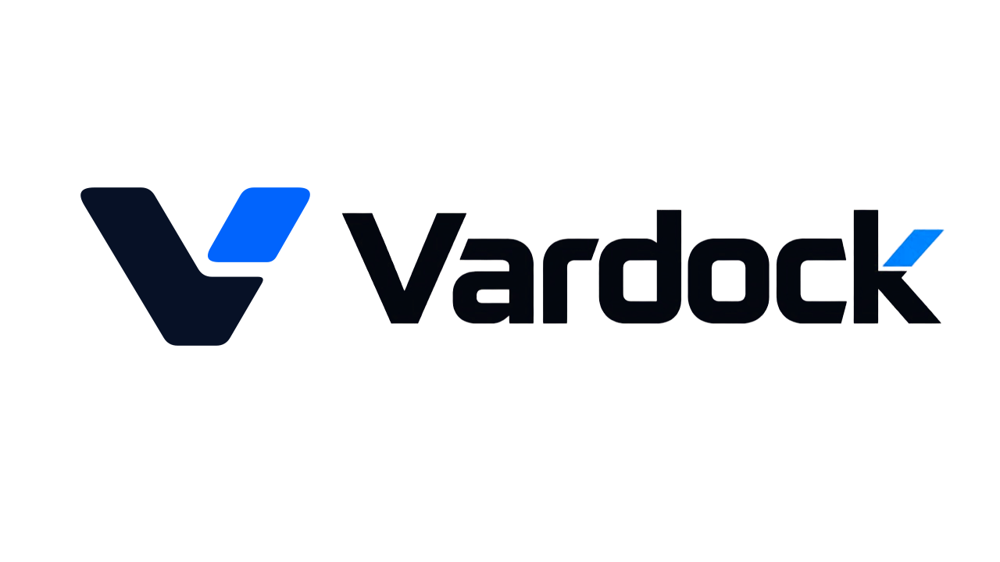
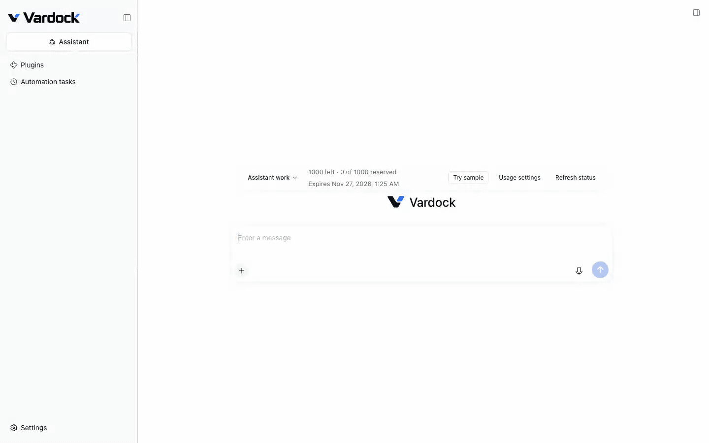
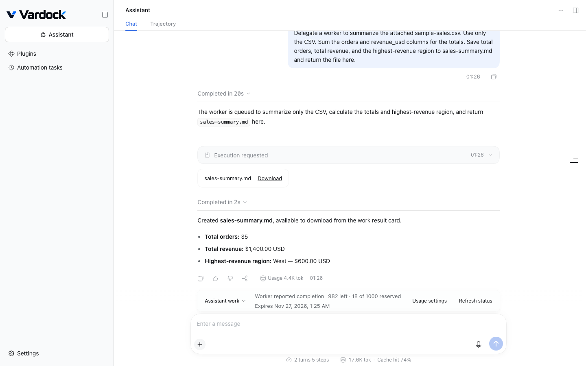
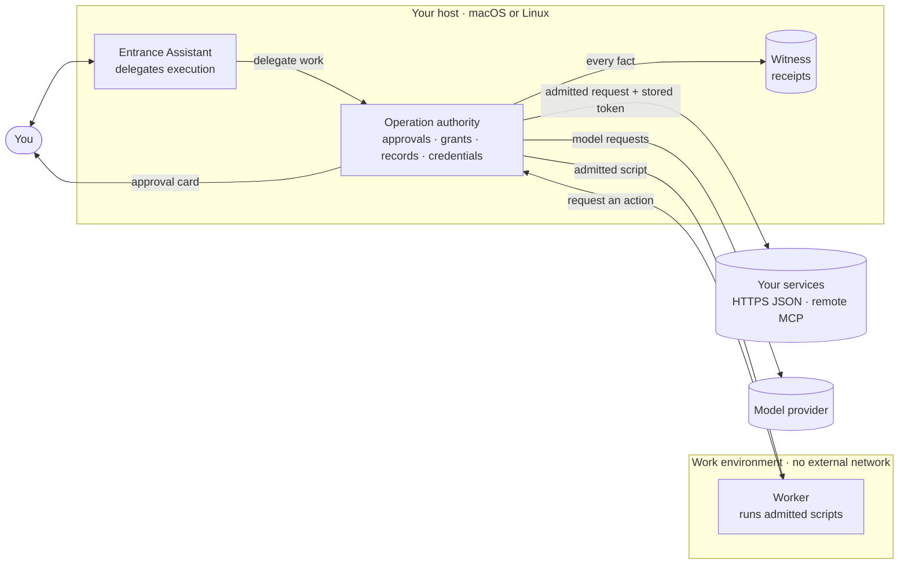
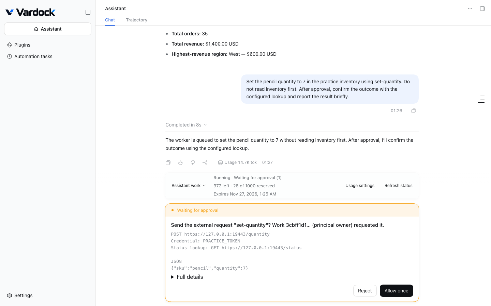
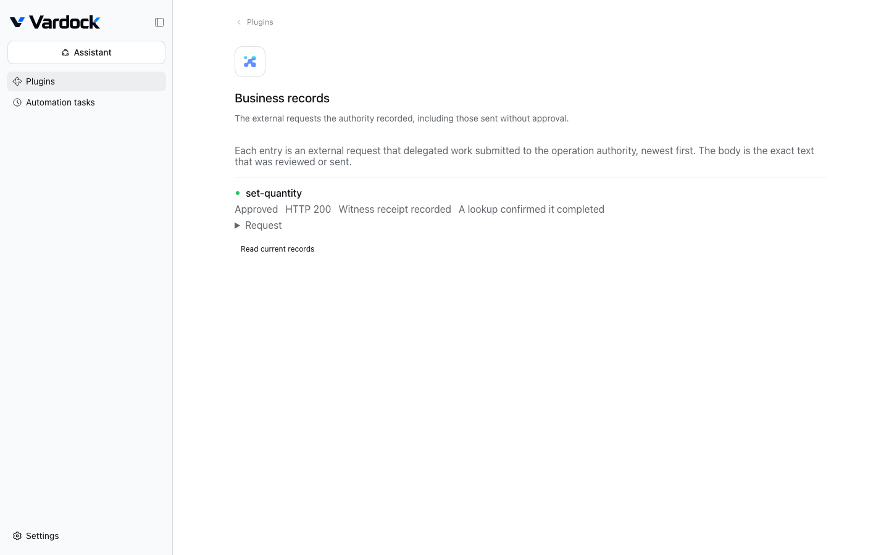

# Vardock

<p align="center">
  <picture>
    <source media="(prefers-color-scheme: dark)" srcset="packages/client/ui-brand-official/src/client/assets/vardock-logo.png">
    
  </picture>
</p>

<p align="center">
  <strong>対話を通じて業務を委任でき、エンドツーエンドで継続稼働する自律型AIエージェントを、厳格なルールの下で運用するためのオープンソース・ハーネス。</strong>
</p>

<p align="center">
  <a href="#start-on-macos">macOS</a> · <a href="#start-on-linux">Linux</a> · <a href="#how-it-works">仕組み</a> · <a href="SAFETY.ja.md">安全性</a> · <a href="packages/experimental/assistant/vardock/README.ja.md">セットアップ</a> · <a href="CONTRIBUTING.ja.md">開発への参加</a> · <a href="CHANGELOG.md">変更履歴（英語）</a>
</p>

<p align="center">
  <a href="LICENSE"></a>
  <a href="#status"></a>
  <a href="packages/experimental/assistant/vardock/README.ja.md"></a>
  <a href="packages/experimental/assistant/vardock/README.ja.md#choose-a-model-provider"></a>
</p>

<div align="center">

[English](README.md) | 日本語 | [中文](README.zh.md)

</div>

Vardockは、各種基盤モデルをAPIやローカルのCodex経由で利用でき、一つの会話窓口から委任された複数の業務を、承認済みの定期タスクも含めてバックグラウンドで実行します。

常時監視を前提としない自律稼働だからこそ、承認要否の判断をモデルのアラインメントやプロンプトの工夫に依存させません。モデルの外側で、別プロセスの操作制御部が固定ルールに従って決定論的に判断します。エージェントが生成したコードは、外部ネットワークから遮断された隔離環境で実行されます。外部サービスとの通信は、ルールに合致するものだけが確認なしで通過し、それ以外は正確な内容を提示して人間の承認を待ちます。すべての操作は別の証拠保全プロセスにも記録され、後から記録の整合性を確認できます。



*「サンプルを試す」からスクリプトの自動実行とレポートの受け取りへ。続いて練習用在庫の更新を承認し、結果を照合します。待ち時間を省き、残した映像は通常速度で再生しています。*



Vardockは[DeepSeek Harness（DSH）](https://github.com/deepseek-ai/deepseek-harness)を基盤とし、そのCordisプラグイン構成を維持しています。独立した派生プロジェクトであり、DeepSeekの公式製品ではなく、同社による承認や推奨を意味しません。

<a id="why-vardock"></a>

## Vardockを選ぶ理由

ローカルのAgentがサービスのトークンを持ち、ネットワークに直接接続できる場合、信頼できないテキストを読むプロセスが、何を送るかも決められます。Vardockはこの役割を分けます。

既定では、外部への業務リクエストは、所有者のルールが許可する場合を除き、保存された正確な依頼に対するあなたの承認を待ちます。メモとタスクの予約は必ず承認を求めます。日常のスクリプトは承認カードなしで実行されます。

| | ツールを直接使うローカルAgent | Vardock |
|---|---|---|
| 対話する相手 | ツールの実行も行うAgent | 実行を委任する、一つの入口のAssistant |
| コードの実行場所 | あなたのShellとネットワーク | macOS：Apple ContainerのLinux VM。Linux：選択したランタイムのDockerコンテナ。ネットワークはループバックのみ。 |
| サービスのトークンの保管先 | Agentのプロセスまたはその環境 | 制御部が保管し、モデルの入力や作業Agentの環境には含めない |
| 承認するもの | Agentが説明するツール呼び出し | 保存された正確な内容。外部リクエストはルールが許可しない場合、メモとタスクの予約は常に承認が必要。スクリプトは個別確認を有効にした場合に対象 |
| 確認が必要かを決めるもの | モデル自身の判断。変動したり、読んだテキストに誘導されたりする可能性がある | あなたが書き、制御部が適用するルール。依頼、ルール、制御部の状態が同じなら判断も同じ |
| 後に残るもの | 会話の記録のみ | 操作記録と、別プロセスの証拠保全による受領記録。`pnpm vardock verify`で突き合わせられる |
| 結果が不明なとき | Agentが再試行する可能性がある | 結果未確認の外部依頼は自動で再送されず、同じアクションへの次の依頼もあなたの判断を待つ。仕事は結果不明と表示される |

これらはVardockが設定した経路に適用されます。保証の範囲と対象外については[安全性の説明](SAFETY.ja.md)を確認してください。

macOSでは、作業環境はApple ContainerのLinux VMです。Linuxでは、ループバック以外のネットワークデバイスを持たないDockerコンテナであり、隔離の強さは選択したランタイムによります。runcはホストのカーネルを共有する通常のコンテナで、VMの隔離境界ではありません。runsc（gVisor）はユーザー空間のカーネルを使います。PID制限が数えるのはサンドボックスのホスト側タスクであり、ゲストのプロセス数は制限しません。Kataは種類としてはVMの隔離境界を提供しますが、本プロジェクトでは未検証です。

<a id="how-it-works"></a>

## 仕組み



図の用語：You＝あなた、Your host＝あなたのホスト、Entrance Assistant＝入口のAssistant、Operation authority＝操作制御部、Witness＝証拠保全、Worker＝作業Agent、Work environment＝作業環境（外部ネットワーク接続なし）、Your services＝あなたのサービス、Model provider＝モデルプロバイダー。

| 手順 | 起こること | 確認できるもの |
|---|---|---|
| 1. 頼む | 入口に話しかけます。入口はスクリプトを実行したりサービスへ接続したりせず、仕事に必要な権限を付けて委任します。 | 仕事の状態、残りの予約、期限が表示されます。 |
| 2. 実行する | 作業Agentがスクリプトを書きます。制御部はそれを保存し、仕事の許可の範囲内で作業環境での自動実行を受け付けます。 | 既定ではスクリプトの承認カードは出ず、実行出力と証拠保全の証拠が残ります。`--review-scripts`を使うと、正確なスクリプトが**1 回だけ許可**を待ちます。 |
| 3. 外部へ依頼する | スクリプトが、設定済みの*アクション*を制御部に依頼します。作業Agentはネットワーク接続もサービスのトークンも持ちません。 | あなたのルールが許可する場合を除き、接続先と正確な本文を示す承認カードが表示されます。 |
| 4. 記録する | 制御部は受け付け、判断、結果をそれぞれ証拠保全に報告し、受領記録を保持します。 | **業務記録**に、ルールで送られたものを含むすべての外部への依頼が並びます。 |
| 5. 照合する | Vardockの実行中に`pnpm vardock verify`で、証拠保全に残る操作イベントと現在の設定の記録を、制御部の受領記録と突き合わせます。 | `OK  Every compared event matches.`、または不一致ごとに1行が表示されます。 |





<a id="what-you-can-do"></a>

## できること

| やりたいこと | Vardockでできること |
|---|---|
| 仕事を任せる | 一つの会話から作業Agentに委任し、結果、待機状況、結果未確認の操作の報告を受ける |
| Agentにコードを実行させる | 隔離された作業環境でShell・Node.js・ファイル処理を自動実行し、実行を記録して証拠保全に確認させる |
| 自分のシステムを接続する | HTTPS JSONルートやリモートMCPサーバーのツールをアクションとして使う。トークンは**接続**から保存し、制御部が保持する |
| 定型的な承認を省く | 制御部が適用する所有者のルールで、最上位の項目の一致条件や、依頼に含めてよいほかの項目を指定する |
| 継続して仕事を頼む | 入口へのタスクの予約とメモは、必ず正確な内容の承認を求める。承認なしルールでこの判断を省くことはできない |
| ファイルをやり取りする | 仕事の転送・開示権限に従い、選択した添付ファイルを取り込み、保全された成果物を受け取る |
| 後から確認する | 再起動後も残る操作記録と証拠保全の受領記録を確認し、サービスが確定できる結果を照合する |

既定の構成は、アクションも一般の外部接続先も許可しません。[ルールの制限](SAFETY.ja.md#approval-recovery-and-completion) · [保証と制限](SAFETY.ja.md#threat-model)

[6段階の在庫練習（英語）](examples/practice/README.md)では、外部サービスのアカウントなしで、リクエストの内容を確認して承認し、証拠保全の受領記録と処理結果を確認できます。続いて読み取りルールを有効にし、読み取りは自動で進み、更新は承認を待つ様子を確認します。

<a id="reads-automatic-sends-reviewed"></a>

### 読み取りは自動、送信は確認

アクションを設定して仕事に利用権限を与えたら、次のように使い分けられます。承認の要否を決めるのはアクション名ではなく、あなたのルールです。[この構成の設定方法](packages/experimental/assistant/vardock/README.ja.md#connect-a-service)。

| 操作 | ルール | 動作 |
|---|---|---|
| 検索・読み取り | 所有者のルールがそのアクションを許可 | 確認なしで送信され、記録と証拠保全の証拠が残る |
| メッセージ送信 | そのアクションを許可する所有者のルールがない | 接続先と保存された正確な本文を承認カードに表示し、送信はあなたの判断を待つ |
| スクリプト実行 | 既定の自動実行設定 | 隔離された作業環境で確認なしに実行され、記録と証拠保全の証拠が残る |

あるアクションへの依頼の結果が未確認なら、そのアクションへの次の依頼を進める前にも判断が必要です。[復旧時のルール](SAFETY.ja.md#approval-recovery-and-completion)。

<a id="run"></a>

<a id="run-from-source"></a>

<a id="start-on-macos"></a>

## macOSではじめる

Vardockは、macOS 26以降のAppleシリコンMacと、ネイティブarm64のNode.js 24.9以降で動作します。セットアップには、Xcode Command Line Tools、Apple Container、リポジトリで固定されたバージョンのpnpmも必要です。

```sh
pnpm install
pnpm vardock setup --model-provider openai --model "<model-id>"
pnpm vardock start
```

`openai`と`<model-id>`は、使うプロバイダーのルートとモデルIDに置き換えてください。起動後、プラグインページの**接続**でAPIキーを保存します。ローカルCodexを使う場合は、先にCodex CLIでログインし、`--model-provider codex-local --model default`を渡してください。[モデルプロバイダーの選択](packages/experimental/assistant/vardock/README.ja.md#choose-a-model-provider)

<a id="start-on-linux"></a>

## Linuxではじめる

Node.js 24.9以降と開発用ヘッダー、Cコンパイラー、固定バージョンのpnpm、`lsof`、lingerを有効にしたsystemdユーザーサービス、cgroup v2とローカルUnixソケットを使えるDocker Engineを用意します。先に選択したランタイムをインストールして登録してください。配備するアカウントのユーザーサービス管理機構がDockerにアクセスできる必要があります。[Linuxの前提条件](packages/experimental/assistant/vardock/README.ja.md#linux)

```sh
pnpm install
pnpm vardock setup --model-provider openai --model "<model-id>" --runtime runsc
pnpm vardock start
```

上記の手順でモデルプロバイダーを選び、キーを保存します。`--runtime runc`は通常のコンテナ隔離、`--runtime runsc`はgVisorを使います。`--runtime kata`は本プロジェクトでは未検証のKataを選び、動作するKVMが必要です。`pnpm vardock doctor`はデーモンの機能、ランタイムの登録、サービスのリスナーを確認しますが、ランタイムの起動や隔離は検証しません。Linuxのstartは所有者トークン付きURLを出力します。秘密に保ち、遠隔アクセスにはSSHポート転送を使ってください。[ランタイムとアクセスの制限](packages/experimental/assistant/vardock/README.ja.md#linux)

以下のオプションとコマンドは両方のプラットフォームに適用されます。

- `--review-scripts`：セットアップに追加すると、すべてのスクリプトに承認が必要になります。[スクリプトの確認](packages/experimental/assistant/vardock/README.ja.md#try-a-first-work-request)。
- `--authority-patch <file>`：セットアップに追加すると、制御部にあなたの設定パッチを適用します。[制御部のパッチ](packages/experimental/assistant/vardock/README.ja.md#connect-a-service)。

| コマンド | 動作 |
|---|---|
| `pnpm vardock start` | 証拠保全、制御部、Web Hostを起動する。macOSは入口を開き、LinuxはURLを表示する |
| `pnpm vardock doctor` | 前提条件と稼働中のサービスを、変更せずに確認する |
| `pnpm vardock verify` | サービスの実行中に、証拠保全に残る操作イベントと現在の設定の記録を、制御部の受領記録と突き合わせる |
| `pnpm vardock stop` | サービスを停止し、データは保持する |

[セットアップガイド](packages/experimental/assistant/vardock/README.ja.md)では、前提条件、オプション、サービスの接続、復旧、削除を説明しています。

<a id="developer-preview"></a>

<a id="status"></a>

## 現在の提供範囲

Vardockは、ソースコードを取得してローカル環境で評価するための開発者向けプレビューです。

| | |
|---|---|
| 新しい環境 | スクリプトは自動実行。外部への業務リクエストは所有者のルールが許可しない限り待機し、メモとタスクの予約は必ず承認を求める。既存環境の設定は変わらない。 |
| 対応範囲 | AppleシリコンmacOSとLinuxで、1人の所有者が使う構成 |
| Linuxの検証範囲 | Docker 29.9、runc、runscを使う1台のarm64 Ubuntu VM |
| Linuxで未検証 | Kata、x86_64、その他のディストリビューション、rootless Docker |
| 提供していないもの | 公開npmパッケージ、デスクトップ用インストーラー、Windowsホスト、複数ユーザー対応 |
| 保証していないもの | ホストが行うすべての操作の仲介、独立したセキュリティ監査、企業向けの隔離 |
| 変更の可能性 | APIや保存済みデータには互換性を保たない変更が入る可能性がある。[アップグレードガイド](docs/upgrade-guide/v0.2.2-rc.2-vardock/)に各変更を記録 |

`npx @deepseek-ai/dsh web`でインストールされるのは上流のDSHであり、このVardock構成ではありません。実行前に[安全性の説明](SAFETY.ja.md)を確認してください。

<a id="terms"></a>

<details>
<summary><strong>文書で使う用語</strong></summary>

| 用語 | 意味 |
|---|---|
| 入口 | あなたが対話する唯一のAssistant会話。仕事を委任して結果を報告し、スクリプトは実行しない。 |
| 作業Agent | 自分のSessionで委任された依頼を一つ実行し、作業環境でスクリプトを実行するAgent。 |
| 制御部 | 操作制御部のプロセス。すべての操作を受け付け、予約し、記録する。モデルとサービスの資格情報も保持する。 |
| 証拠保全 | 制御部が報告する各事実を保存し、受領記録を返す別プロセス。 |
| Broker | 制御部の中のProvider。受け付けた依頼を、保存済みのトークンを使って設定済みのHTTPSエンドポイントまたはリモートMCPツールへ送る。 |
| アクション | 設定済みのBrokerルートまたはMCPツール一つを表すID。仕事は、その許可に記載されたアクションだけを依頼できる。 |
| 許可 | 制御部が適用する権限、予約上限、期限。委任ごとに、その範囲内の許可が与えられる。 |
| 予約 | 許可の上限の1単位。モデルリクエスト、スクリプト、Brokerの依頼、ファイル転送、委任、入口の応答がそれぞれ1つ使う。 |
| 承認なしルール | 条件に合う操作を判断なしで受け付ける、所有者または運用者のルール。制御部はその操作も記録し、証拠保全に送る。 |

</details>

<a id="composition-and-development"></a>

<a id="documentation"></a>

## ドキュメント

| 文書 | 内容 |
|---|---|
| [安全性](SAFETY.ja.md) | 脅威モデル、各保証の範囲と制限 |
| [セットアップガイド](packages/experimental/assistant/vardock/README.ja.md) | インストール、サービスの接続、復旧、削除 |
| [Assistant](packages/experimental/assistant/README.md) | 入口、委任、タスクの予約、メモ、`pnpm vardock`コマンド |
| [操作制御部](packages/experimental/operation-control/README.md) · [証拠保全](packages/experimental/operation-evidence/README.md) · [Broker](packages/experimental/operation-broker/README.md) | 制御部、証拠保全、あなたのサービスへの経路 |
| [実行コンテナ](packages/experimental/execution-container/README.md) | 作業環境とその制限 |
| [開発への参加](CONTRIBUTING.ja.md) · [DSHのアーキテクチャ](docs/architecture.md) · [開発ガイド](docs/development.md) | Vardockの変更方法 |
| [セキュリティポリシー](SECURITY.ja.md) · [行動規範](CODE_OF_CONDUCT.ja.md) · [変更履歴](CHANGELOG.md) | 脆弱性の報告、行動規範、リリース |

<a id="relation-to-deepseek-harness"></a>

<a id="built-on-deepseek-harness"></a>

## DeepSeek Harnessを基盤に

DeepSeek Harnessは、Agentの実行基盤、プラグインシステム、Session、ツール、承認UI、そしてこのリポジトリの大部分を提供しています。Vardock独自のパッケージは、`packages/experimental/`配下の`assistant`、`operation-control`、`operation-evidence`、`operation-broker`、`execution-container`、[`llm-codex`](packages/experimental/llm-codex/README.md)です。これらもCordisコンポーネントであり、宣言されたサービスとProfile設定を通じてProviderを差し替えられます。AgentのループはDSHのものです。継承した文書には、Vardockの構成では読み込まないProfile、ツール、機能の説明もあります。既存の`dsh`コマンドや`@deepseek-ai/dsh-*`パッケージ名は、技術的な識別子として維持しています。

上流のCI自動化（GitHub Actionsのワークフロー、GitLabのパイプライン、リリースと公開のワークフロー、Issueとレビューの振り分け、Dependabot設定）はVardockには含まれず、このリポジトリではホステッドCIを使いません。上流の変更を取り込む際は、これらの自動化と、それだけのために存在するスクリプトやテストへの変更を除いてください。継承した`pnpm run release:*`スクリプトと`@deepseek-ai`パッケージ名前空間はDSHの基盤であり、Vardockの配布経路ではありません。公開先の設定と再配布要件の確認なしに、Vardockのパッケージや同梱バイナリの公開に使わないでください。

VardockはVirtualHatch Inc.で作成されました。

<a id="get-in-touch"></a>

## お問い合わせ

- 質問やアイデア：[GitHub Discussions](https://github.com/VirtualHatch-Inc/Vardock/discussions)。
- VirtualHatchへのお問い合わせ：[お問い合わせフォーム](https://vhatch.co.jp/contact/)。
- セキュリティ上の報告：[セキュリティポリシー](SECURITY.ja.md)に従ってください。

Vardockの開発チームは、一緒に作っていきたい方を探しています。興味があれば、上の窓口から声をかけてください。

<a id="upstream-attribution-and-license"></a>

<a id="license"></a>

## ライセンス

DeepSeek Harnessの元の著作権表示と[MITライセンス](LICENSE)を維持し、Vardockのソースコードの変更も同じMIT条項で配布します。独自のライセンスを持つ依存関係は[サードパーティーの通知](THIRD_PARTY_NOTICES.md)に記載しています。MITライセンスは、それらの条項に代わるものではありません。

Vardockの名称とロゴはこのプロジェクトを示すもので、MIT条項の許諾対象には含まれません。派生プロジェクトには独自の名称とアートワークが必要です。ロゴはChatGPTを使って作成され、プロジェクト所有者が提供し、本プロジェクトとともに再配布する許可を確認しています。DeepSeekによる承認や推奨を意味するものではありません。上流のDeepSeekの名称とアートワークには、引き続き[上流のブランドガイドライン](BRAND_GUIDELINES.ja.md)が適用されます。
