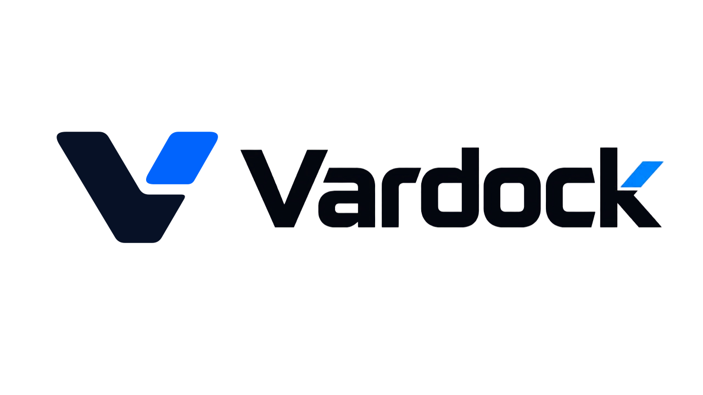
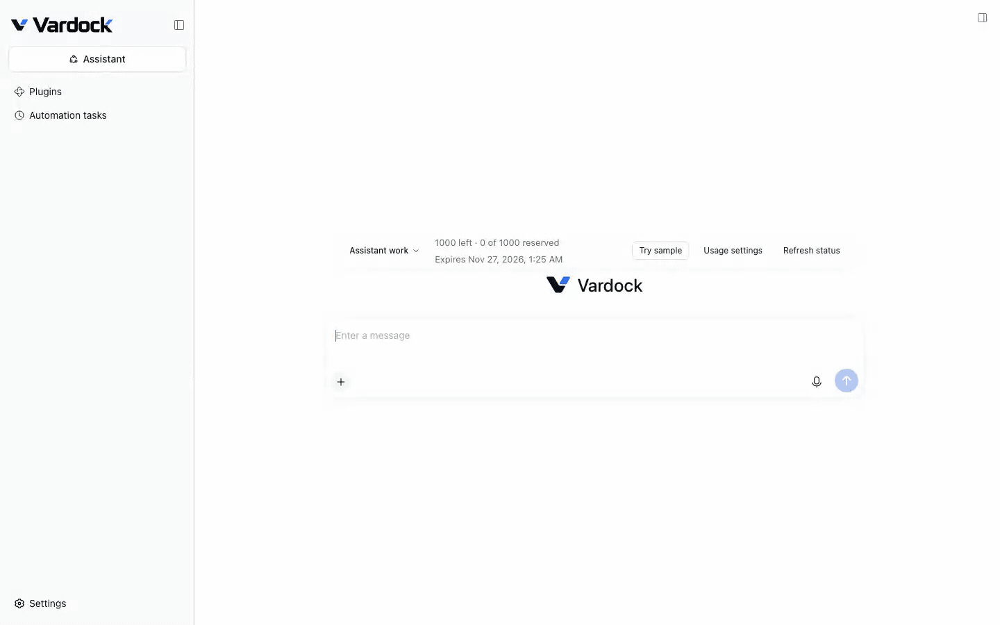
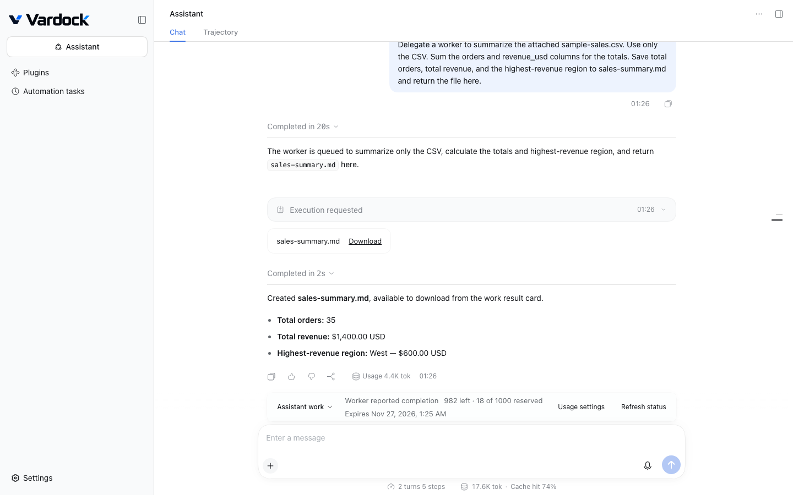
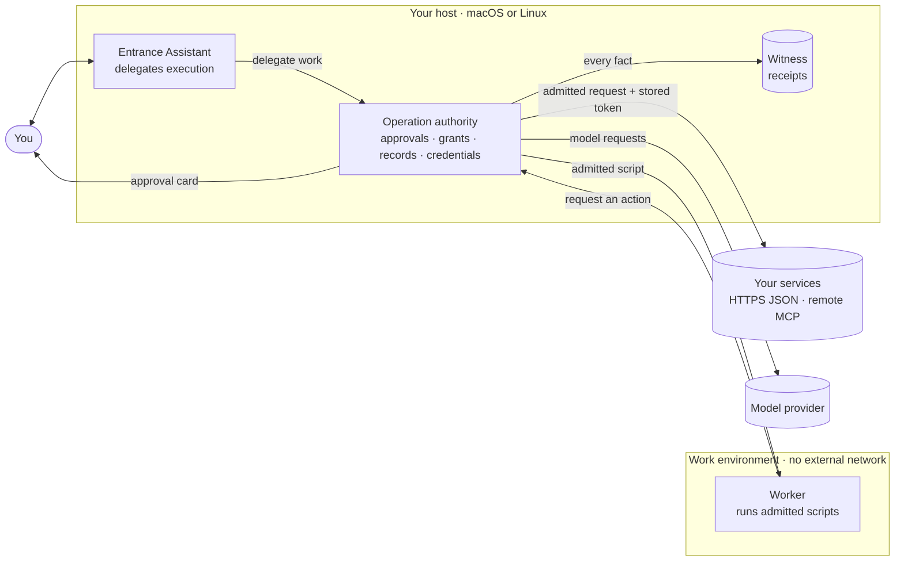
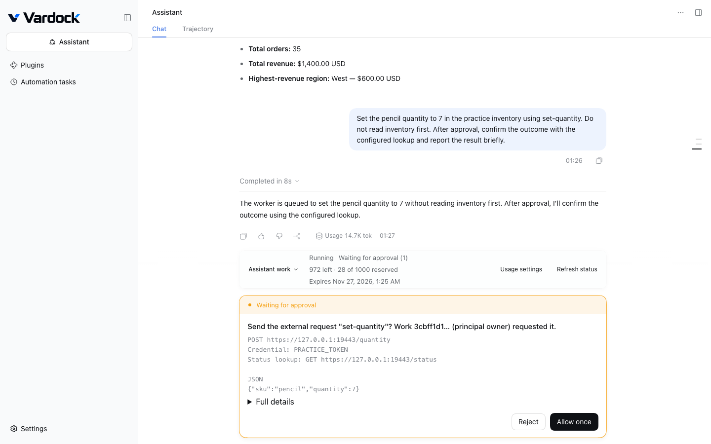
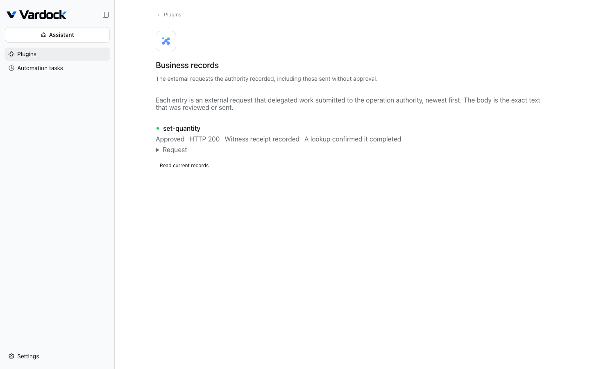

# Vardock

<p align="center">
  <picture>
    <source media="(prefers-color-scheme: dark)" srcset="packages/client/ui-brand-official/src/client/assets/vardock-logo.png">
    
  </picture>
</p>

<p align="center">
  <strong>一个开源 Harness，让你通过对话委派业务，并在严格规则下运行端到端持续工作的自主 AI 智能体。</strong>
</p>

<p align="center">
  <a href="#start-on-macos">macOS</a> · <a href="#start-on-linux">Linux</a> · <a href="#how-it-works">工作原理</a> · <a href="SAFETY.zh.md">安全说明</a> · <a href="packages/experimental/assistant/vardock/README.zh.md">设置指南</a> · <a href="CONTRIBUTING.zh.md">贡献指南</a> · <a href="CHANGELOG.md">变更日志</a>
</p>

<p align="center">
  <a href="LICENSE"></a>
  <a href="#status"></a>
  <a href="packages/experimental/assistant/vardock/README.zh.md"></a>
  <a href="packages/experimental/assistant/vardock/README.zh.md#choose-a-model-provider"></a>
</p>

<div align="center">

[English](README.md) | [日本語](README.ja.md) | 中文

</div>

Vardock 可通过 API 或本地 Codex 使用各种基础模型，并在后台执行从同一个对话入口委派的多项业务，包括已批准的定时任务。

正因为自主运行不以用户时刻监督为前提，是否需要批准的判断不依赖模型的对齐程度或提示词技巧，而是在模型之外，由单独运行的控制服务按照固定规则确定性地作出。智能体生成的代码在与外部网络隔绝的隔离环境中运行。与外部服务的通信只有符合规则才会不经确认直接放行，否则展示确切内容并等待人工批准。所有操作还会记录到独立的见证服务进程中，事后可以核对记录是否一致。



*试用示例后，脚本自动运行并返回报告；随后批准练习库存更新并确认结果。等待片段已剪去，保留画面按正常速度播放。*



Vardock 基于 [DeepSeek Harness（DSH）](https://github.com/deepseek-ai/deepseek-harness)，保留了其 Cordis 插件架构。这是一个独立的派生项目，并非 DeepSeek 官方产品，也不代表 DeepSeek 背书。

<a id="why-vardock"></a>

## 为什么选择 Vardock

当本地智能体持有服务令牌并能直接联网时，读取不可信文本的进程也能决定发送什么。Vardock 将这些职责分开。

默认情况下，外部业务请求等待你批准保存的确切请求，除非所有者规则允许。笔记和定时任务始终需要批准。日常脚本运行时不显示审批卡片。

| | 直接使用工具的本地智能体 | Vardock |
|---|---|---|
| 谁与你对话 | 同时执行工具的智能体 | 一个将执行工作委派出去的入口 Assistant |
| 代码在哪里运行 | 你的 Shell 和网络 | macOS：Apple Container Linux VM。Linux：使用所选运行时的 Docker 容器。只有回环网络。 |
| 谁持有服务令牌 | 智能体进程或其环境 | 控制服务保存，不放入模型输入或工作智能体的环境 |
| 你批准什么 | 智能体所描述的工具调用 | 保存的确切内容：外部请求未获规则放行时需要批准；笔记和定时任务始终需要批准；启用逐一审查时也包括脚本 |
| 谁决定是否征求你的批准 | 模型自己的判断，可能变化，也可能受所读文本引导 | 你编写、由控制服务执行的规则；请求、规则和控制服务状态相同，决定就相同 |
| 事后留下什么 | 只有聊天记录 | 操作记录及独立见证进程的回执，可用 `pnpm vardock verify` 比对 |
| 结果未知时 | 智能体可能重试 | 结果未确认的外部请求不会自动重发；同一操作的后续请求也等待你的决定，工作显示结果未知 |

这些特性适用于 Vardock 配置的路径。[安全说明](SAFETY.zh.md)列出了保证的范围及不涵盖的内容。

在 macOS 上，工作环境是 Apple Container Linux VM。在 Linux 上，它是只有回环网络设备的 Docker 容器；隔离强度取决于所选运行时。runc 是共享宿主内核的普通容器，不是 VM 隔离边界。runsc（gVisor）使用用户态内核；其 PID 限制计算沙箱的宿主任务，不限制来宾进程数。Kata 在类型上提供 VM 隔离边界，但本项目尚未验证它。

<a id="how-it-works"></a>

## 工作原理



图中用语：You＝你，Your host＝你的主机，Entrance Assistant＝入口 Assistant，Operation authority＝操作控制服务，Witness＝见证服务，Worker＝工作智能体，Work environment＝工作环境（无外部网络），Your services＝你的服务，Model provider＝模型 Provider。

| 步骤 | 发生什么 | 你会看到什么 |
|---|---|---|
| 1. 提出需求 | 你与入口对话。入口不能运行脚本或访问服务，而是带着工作所需的权限委派工作。 | 工作及其状态、剩余预留次数和到期时间。 |
| 2. 执行 | 工作智能体编写脚本。控制服务保存脚本，并在工作授权范围内准入工作环境中的自动执行。 | 默认没有脚本审批卡片，留下执行输出和见证证据。使用 `--review-scripts` 时，确切的脚本等待你选择**允许一次**。 |
| 3. 访问外部服务 | 脚本请求控制服务执行已配置的*操作*。工作智能体不能联网，也没有服务令牌。 | 展示目标和确切正文的审批卡片，除非你的规则已放行该请求。 |
| 4. 记录 | 控制服务向见证服务报告每次准入、决定和结果，并保存回执。 | **业务记录**列出每次外部请求，包括规则放行的请求。 |
| 5. 核查 | 在 Vardock 运行期间，`pnpm vardock verify` 将见证服务记录的操作事件和当前配置记录与控制服务的回执比对。 | `OK  Every compared event matches.`，或每项不一致各显示一行。 |





<a id="what-you-can-do"></a>

## 可以做什么

| 你想做什么 | Vardock 提供什么 |
|---|---|
| 交办任务 | 在一个会话中向工作智能体委派工作，接收结果、等待状态及未确认结果的报告 |
| 让智能体运行代码 | 在隔离工作环境中自动执行 Shell、Node.js 和文件处理，并记录执行与见证证据 |
| 连接自己的系统 | 通过 HTTPS JSON 路由或远程 MCP 服务器的工具提供操作；令牌在**连接**中保存，由控制服务持有 |
| 省去例行审批 | 控制服务执行所有者规则，可设置顶层字段匹配条件，并限定请求还可携带哪些字段 |
| 持续安排工作 | 入口的定时任务与笔记始终需要你批准确切内容；无人值守规则不能跳过这一决定 |
| 传递文件 | 按照工作的传输和披露权限导入选中的附件，取回保全的产物 |
| 事后核查 | 重启后仍保留的操作记录和见证回执，以及对服务可确认结果的查询 |

默认配置不允许任何操作或一般外部目标。[规则限制](SAFETY.zh.md#approval-recovery-and-completion) · [保证和限制](SAFETY.zh.md#threat-model)

通过[六阶段库存练习](examples/practice/README.zh.md)，无需外部服务账户即可审批完整请求、查看见证凭证并确认结果。随后启用读取规则，观察读取自动执行而更新仍等待审批。

<a id="reads-automatic-sends-reviewed"></a>

### 读取自动，发送审查

配置操作并授予工作使用权限后，可以采用以下模式。决定是否批准的是你的规则，而不是操作名称。[配置此模式](packages/experimental/assistant/vardock/README.zh.md#connect-a-service)。

| 操作 | 规则 | 结果 |
|---|---|---|
| 搜索或读取 | 所有者规则允许该操作 | 无需询问，发送并记录请求及见证证据 |
| 发送消息 | 没有所有者规则允许该操作 | 审批卡片显示目标和保存的确切正文；发送等待你的决定 |
| 运行脚本 | 默认的自动脚本设置 | 在隔离工作环境中直接运行，并记录执行与见证证据 |

如果某项操作已有结果未确认的请求，该操作的后续请求仍须等待决定。[恢复规则](SAFETY.zh.md#approval-recovery-and-completion)。

<a id="run"></a>

<a id="run-from-source"></a>

<a id="start-on-macos"></a>

## 在 macOS 上开始

Vardock 支持运行 macOS 26 或更高版本的 Apple 芯片 Mac，并要求使用原生 arm64 的 Node.js 24.9 或更高版本。设置还需要 Xcode Command Line Tools、Apple Container 和仓库固定版本的 pnpm。

```sh
pnpm install
pnpm vardock setup --model-provider openai --model "<model-id>"
pnpm vardock start
```

将 `openai` 和 `<model-id>` 替换为你的 Provider 路由及其模型 ID，然后在插件页的**连接**中保存 API 密钥。如要改用 Local Codex，请先用 Codex CLI 登录，并传入 `--model-provider codex-local --model default`。[选择模型 Provider](packages/experimental/assistant/vardock/README.zh.md#choose-a-model-provider)

<a id="start-on-linux"></a>

## 在 Linux 上开始

安装 Node.js 24.9 或更高版本及开发头文件、C 编译器、固定版本的 pnpm、`lsof`、启用 lingering 的 systemd 用户服务，以及支持 cgroup v2 和本地 Unix socket 的 Docker Engine。先安装并注册所选运行时。部署账户的用户服务管理器需要访问 Docker。[Linux 前提条件](packages/experimental/assistant/vardock/README.zh.md#linux)

```sh
pnpm install
pnpm vardock setup --model-provider openai --model "<model-id>" --runtime runsc
pnpm vardock start
```

按上文选择模型 Provider 并保存密钥。`--runtime runc` 使用普通容器隔离；`--runtime runsc` 使用 gVisor；`--runtime kata` 选择本项目尚未验证的 Kata，并需要可用的 KVM。`pnpm vardock doctor` 检查守护进程能力、运行时注册和服务监听器；它不验证运行时启动或隔离。Linux start 输出带所有者令牌的 URL：请保密，并通过 SSH 端口转发远程访问。[运行时与访问限制](packages/experimental/assistant/vardock/README.zh.md#linux)

以下选项和命令适用于两个平台：

- `--review-scripts`：在设置时添加，要求每个脚本都经批准。[脚本审查](packages/experimental/assistant/vardock/README.zh.md#try-a-first-work-request)。
- `--authority-patch <file>`：在设置时添加，应用你的控制服务配置补丁。[控制服务补丁](packages/experimental/assistant/vardock/README.zh.md#connect-a-service)。

| 命令 | 用途 |
|---|---|
| `pnpm vardock start` | 启动见证服务、控制服务和 Web Host；macOS 打开入口，Linux 打印入口 URL |
| `pnpm vardock doctor` | 检查前置条件和运行中的服务，不作修改 |
| `pnpm vardock verify` | 在服务运行期间，将见证服务记录的操作事件和当前配置记录与控制服务的回执比对 |
| `pnpm vardock stop` | 停止服务并保留数据 |

[设置指南](packages/experimental/assistant/vardock/README.zh.md)说明前置条件、选项、连接服务、恢复和移除方法。

<a id="developer-preview"></a>

<a id="status"></a>

## 当前状态

Vardock 是供开发者从源码检出后在本地评估的预览软件。

| | |
|---|---|
| 新部署 | 脚本自动运行；外部业务请求等待批准，除非所有者规则允许；笔记和定时任务始终需要批准。现有部署保留其设置。 |
| 支持 | Apple 芯片 macOS 和 Linux 上的单所有者部署 |
| Linux 验证范围 | 一台 arm64 Ubuntu VM，使用 Docker 29.9、runc 和 runsc |
| Linux 未验证 | Kata、x86_64、其他发行版和 rootless Docker |
| 不提供 | 已发布的 npm 包或桌面安装程序；Windows 主机；多用户支持 |
| 不作保证 | 对宿主所有行为的完整仲介、独立安全审计或企业级隔离 |
| 可能变更 | API 和保存的状态可能发生不兼容变更；[升级指南](docs/upgrade-guide/v0.2.2-rc.2-vardock/)记录每项破坏性变更 |

`npx @deepseek-ai/dsh web` 安装的是上游 DSH，不会安装此 Vardock 配置。运行本项目前请阅读[安全说明](SAFETY.zh.md)。

<a id="terms"></a>

<details>
<summary><strong>文档中的用语</strong></summary>

| 用语 | 含义 |
|---|---|
| 入口 | 你与之对话的唯一 Assistant 会话。它委派工作并报告结果，不运行脚本。 |
| 工作智能体 | 在自己的 Session 中执行一个受委派请求，并在工作环境中运行脚本的 Agent。 |
| 控制服务 | 操作控制服务进程，准入、预留并记录每项操作，持有模型和服务凭据。 |
| 见证服务 | 独立进程，保存控制服务报告的每项事实，并返回回执。 |
| Broker | 控制服务内的 Provider，使用已保存的令牌，将获准请求发往配置的 HTTPS 端点或远程 MCP 工具。 |
| 操作 | 一个已配置 Broker 路由或 MCP 工具的 ID。工作只能请求其授权列出的操作。 |
| 授权 | 控制服务实施的权限、预留上限和到期时间。每次委派都在其范围内获得授权。 |
| 预留 | 授权限额的一个单位；每次模型请求、脚本、Broker 请求、文件传输、委派及入口响应各占一个。 |
| 无人值守规则 | 所有者或操作员设定的规则，无需人工决定即可准入匹配的操作。控制服务仍会记录这些操作并交由见证服务保全。 |

</details>

<a id="composition-and-development"></a>

<a id="documentation"></a>

## 文档

| 文档 | 内容 |
|---|---|
| [安全说明](SAFETY.zh.md) | 威胁模型、各项保证的范围及限制 |
| [设置指南](packages/experimental/assistant/vardock/README.zh.md) | 安装、连接服务、恢复、移除 |
| [Assistant](packages/experimental/assistant/README.zh.md) | 入口、委派、定时任务、笔记及 `pnpm vardock` 命令 |
| [操作控制服务](packages/experimental/operation-control/README.zh.md) · [证据见证服务](packages/experimental/operation-evidence/README.zh.md) · [Broker](packages/experimental/operation-broker/README.zh.md) | 控制服务、见证服务及通往你的服务的路由 |
| [执行容器](packages/experimental/execution-container/README.zh.md) | 工作环境及其限制 |
| [贡献指南](CONTRIBUTING.zh.md) · [DSH 架构](docs/architecture.zh.md) · [开发指南](docs/development.zh.md) | 修改 Vardock |
| [安全策略](SECURITY.zh.md) · [行为准则](CODE_OF_CONDUCT.zh.md) · [变更日志](CHANGELOG.md) | 漏洞报告、行为规范和版本发布 |

<a id="relation-to-deepseek-harness"></a>

<a id="built-on-deepseek-harness"></a>

## 基于 DeepSeek Harness

DeepSeek Harness 提供智能体运行时、插件系统、Session、工具、批准 UI 以及本仓库的大部分内容。Vardock 自有的包位于 `packages/experimental/` 下：`assistant`、`operation-control`、`operation-evidence`、`operation-broker`、`execution-container` 和 [`llm-codex`](packages/experimental/llm-codex/README.zh.md)。它们仍然是 Cordis 组件：通过声明的服务和 Profile 配置替换 Provider；Agent 循环仍使用 DSH 的实现。继承的文档可能描述 Vardock 部署未挂载的 Profile、工具和功能，现有 `dsh` 命令和 `@deepseek-ai/dsh-*` 包名仍保留为技术标识符。

上游的 CI 自动化（GitHub Actions 工作流、GitLab 流水线、发布与公开工作流、Issue 与评审路由以及 Dependabot 配置）不属于 Vardock，本仓库不使用托管 CI。合并上游变更时，丢弃对这些自动化以及仅为其服务的脚本和测试的修改。继承的 `pnpm run release:*` 脚本和 `@deepseek-ai` 包命名空间属于 DSH 基础设施，并非 Vardock 发布渠道。在配置发布目标并审查再分发要求之前，不要用它们发布 Vardock 包或打包二进制文件。

Vardock 由 VirtualHatch Inc. 创建。

<a id="get-in-touch"></a>

## 联系我们

- 问题和想法：[GitHub Discussions](https://github.com/VirtualHatch-Inc/Vardock/discussions)。
- 联系 VirtualHatch：[联系表单](https://vhatch.co.jp/contact/)。
- 安全问题报告：请遵循[安全策略](SECURITY.zh.md)。

Vardock 团队正在寻找愿意和我们一起构建它的人。如果你有兴趣，欢迎通过以上渠道联系我们。

<a id="upstream-attribution-and-license"></a>

<a id="license"></a>

## 许可证

DeepSeek Harness 的原始版权声明和 [MIT 许可证](LICENSE)保持不变，Vardock 的源码修改按相同的 MIT 条款分发。[第三方声明](THIRD_PARTY_NOTICES.md)记录了具有各自许可证的依赖；MIT 许可证不替代这些条款。

Vardock 名称和标志用于标识本项目，不在 MIT 条款的许可范围内；派生项目需要自己的名称和图案。标志使用 ChatGPT 创建，由项目所有者提供；所有者已确认允许随本项目再分发。该图案不表示 DeepSeek 背书。上游 DeepSeek 名称和图案仍适用[上游品牌指南](BRAND_GUIDELINES.zh.md)。
